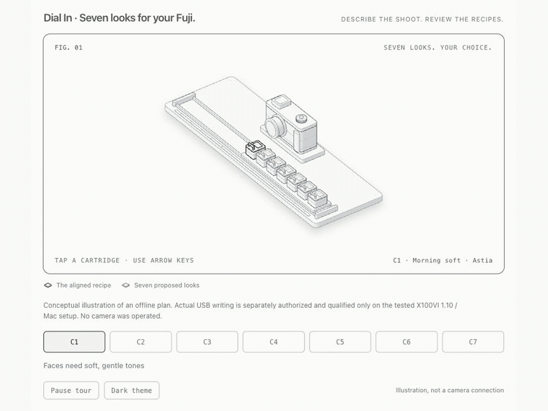
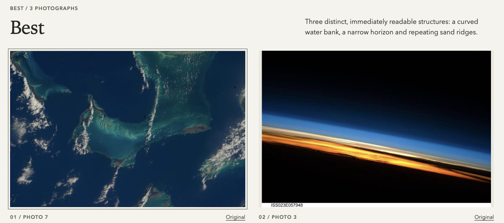

# Dial In

[](https://github.com/maam00/dialin-tools/actions/workflows/desktop.yml)
[](LICENSE)
[](https://github.com/maam00/dialin-tools/releases)

**Your Fuji, with a photography assistant. Describe the shoot. Review seven looks. Load your camera. Come home to a considered photo edit.**

<picture>
  <source media="(prefers-reduced-motion: reduce)" srcset="docs/media/workflow-poster.png">
  
</picture>

[Try a real photo folder](docs/FIRST-SHOOT.md) · [Help add your camera](docs/ADD-YOUR-CAMERA.md)

*Illustration of an offline plan. [Still image and sources](docs/media/README.md).*

I built Dial In because I love shooting with my Fujifilm, but I don't enjoy choosing recipes, changing every setting and sorting through everything afterward. It gives the technical and organizational work to the coding agent I already use, while I keep the final say on the looks and photographs.

Dial In is a free, open-source toolkit for **Fujifilm photographers who already use Claude Code, Codex or a terminal**. It connects the three jobs around a shoot:

1. **Find the right looks for the light you'll shoot in.** Describe the day, optionally with a scene photo; your agent proposes seven complementary film-simulation recipes, and every setting is checked against what Dial In has written and read back on an X100VI over USB: all 20 film simulations, Auto/Daylight/Kelvin white balance, Color −1 to +3 and noise reduction −4.
2. **Put them on the camera without menus.** Recipes go into the custom slots you name (C1–C7) over USB-C, after a backup of all seven slots, with every value read back.
3. **Get your best photos out of the shoot.** Your agent looks at labeled contact sheets and picks your Best, a Series and a Sequence. One command checks those picks against your own choices, copies the originals into folders, and makes a local gallery you can open in your browser. Originals are never modified.

Each tool works on its own, from ordinary JSON files and folders. **No Dial In app, account or separate API key.** Use your existing coding agent; its normal image processing and usage costs still apply. Camera writes are supported only on the **X100VI, firmware 1.10, over USB on the tested Mac setup**. Planning and JPEG/PNG photo-folder review need no connected camera. Check the [capability table](docs/CAPABILITIES.md) before choosing a camera operation.

**Own a different Fuji?** You can use the photo-folder tools now. To help qualify your camera, start with a [current-slot-only report](docs/ADD-YOUR-CAMERA.md), review it for private information, and submit the camera-report issue. A report does not enable writes.

## USB-C and wireless

Dial In uses USB-C, Bluetooth and Wi-Fi for different parts of the workflow:

| Connection | What you can do | Status |
| --- | --- | --- |
| **USB-C** | Load recipes into selected C1–C7 slots, with backup and readback | Supported on X100VI 1.10 and the tested Mac |
| **Bluetooth** | Pair the Mac, back up camera settings and start the camera's Wi-Fi | Included in the desktop helper; observed on X100VI 1.10 |
| **Wi-Fi** | Import full-size JPEGs to the Mac after the Bluetooth connection starts Wi-Fi | Verified on X100VI 1.10 and one Mac |
| **Bluetooth recipe loading** | Run a supervised single-slot write, check and restore trial | Experimental; normal recipe writes remain disabled |

USB-C photo import is also implemented in the helper, but the Wi-Fi test does not qualify that separate route. Other bodies, firmware and hosts still need their own checks. On macOS 26+ with Swift 6.2+, build the desktop helper once, then import over Wi-Fi:

```sh
node scripts/dialin.mjs doctor import
node scripts/dialin.mjs native build
node scripts/dialin.mjs import wifi --last 7 --dest .dialin/imported --out .dialin/import.json
```

Unplug USB before Wi-Fi; use `--pair` for an explicitly requested first registration. Bluetooth wakes the camera and Wi-Fi transfers the photos, temporarily taking the Mac off its usual network. **Bluetooth recipe loading is experimental and remains disabled in production.** The supervised single-slot trial is included, with backup, readback and restore steps. [Setup, commands and exact limits](docs/WIRELESS.md).

## Try it in a minute

Needs Node.js 22.12+ and Python 3.10+. No camera, account or API key.

```sh
npm ci --ignore-scripts
npm run dialin -- demo --out .dialin/demo
```

Then read `.dialin/demo/SUMMARY.md`: a seven-look plan run through the real planner engine, its offline camera-slot preparation, and a validated photo sequence. It is a rehearsal with bundled fixture data: no AI planning, camera write or photo review happens, and the summary says so.

For a real visual review, follow [Your first shoot](docs/FIRST-SHOOT.md). It includes a small, explicitly downloaded NASA photograph set, or you can bring your own folder. Your agent opens the photographs, makes an edit and produces a local `index.html` gallery with Best, Series and Sequence.

## Example photo gallery

The finished gallery keeps your Best, Series and Sequence together with the reasoning behind each choice. Here are two of the three Best picks from the [Earth from orbit example](examples/photos/earth-from-orbit/README.md):



*NASA archive photographs, selected in a saved review replay. This demonstrates photo selection, not the rendering of the proposed camera looks. [Sources and credits](docs/media/README.md#nasa-gallery-example).*

## Use it with your coding agent

Open the repository in Codex or Claude Code and ask, for example:

> “Plan seven complementary looks for tomorrow: outdoor portraits, a walk in hard sun, and dinner indoors. Use my scene photo too. Show me the reasoning before preparing the camera.”

> “I already have my recipes in this JSON file. Check whether I can put them in C2 and C7 on my X100VI. Keep the other slots.”

> “Here's today's shoot folder. Give me my best 10, the strongest series of about 5, and the sequence of the day. Keep the boat close-up.”

Your agent supplies the visual and editorial judgment; the tools validate settings, preserve photo identities, enforce your constraints and save results as ordinary files. [Agent instructions](docs/AGENT-WORKFLOW.md) list the exact commands and handoffs.

For close burst decisions, the agent can generate [labeled 100% crops from the originals](modules/photos/README.md#check-focus-before-choosing-a-burst-keeper), inspect the relevant eye/subject in each candidate, and record its comparison before claiming focus checked. Region selection and judgment come from the agent; the tool does not automatically detect eyes or score sharpness.

## Pick a component

Each component works on its own. Run `npm run dialin -- doctor <component>` first: it checks only that component's prerequisites, makes no network, model or camera call, and tells you the fix for anything missing.

| I want to… | Guide | Needs |
| --- | --- | --- |
| Plan the looks for a shoot from a description and/or scene photo | [Planner](modules/planner/README.md) | Node.js and your coding agent (API key optional) |
| Explore the recipe guidance or check my own recipe book | [Recipes](modules/recipes/README.md) | Node.js |
| Put recipes into chosen camera slots | [Camera](modules/camera/README.md) | Node.js; an X100VI on firmware 1.10 for the USB write |
| Get photographs off the camera | [Import](modules/import/README.md) | Wi-Fi via Bluetooth setup on the tested Mac, the USB-C helper, or SD-card/OS import |
| Back up settings or supervise a Bluetooth recipe trial | [Bluetooth and wireless](docs/WIRELESS.md) | Optional macOS helper; recipe loading remains experimental |
| Get my Best, Series and Sequence from a photo folder, and see which look each photo was shot with | [Photos](modules/photos/README.md) | Python + Pillow and your agent's image viewing |
| Validate a selection and sequence from another tool | [Curation](modules/curation/README.md) | Python standard library |
| Try the photo workflow without my own photos | [Synthetic demo shoot](examples/photos/README.md) | Python + Pillow; original drawings labeled SYNTHETIC |
| Help support another Fujifilm body | [Add your camera](docs/ADD-YOUR-CAMERA.md) | Node.js and the camera on USB; read-only |

First commands, from the repository root:

```sh
npm run dialin -- plan --mode agent --text "Morning portraits, a market, dinner indoors" --out .dialin/my-shoot/request.json
npm run dialin -- camera prepare --in examples/camera/own-recipes.json --slots C2,C7 --model X100VI --firmware 1.10 --transport usb --out .dialin/my-camera.json
npm run dialin -- photos prepare --input /path/to/photos --out .dialin/my-photos --intent "A quiet travel story" --count 8
npm run dialin -- photos finish --workspace .dialin/my-photos --out .dialin/my-photos-finished
npm run dialin -- recipes knowledge --query "portraits in open shade"
```

`plan` writes a request your agent answers; `photos finish` runs after your agent has filled the review sheet that `photos prepare` creates. Open the resulting `index.html` to see the selections and their explanations; the result folder works offline and can be moved with its contents. Results are JSON on stdout, or new files with `--out`; existing files are never overwritten and original photographs are never modified. `npm run recipes|plan|cam|photos|curate -- …` are shortcuts for the same commands. `npm run dialin -- --help` lists everything.

## Setup details

- **Node.js 22.12+** runs the CLI; `npm ci --ignore-scripts` installs its dependencies. `--help` and `doctor` work before installation.
- **Python 3.10+** runs curation with no packages. Photo preparation also needs Pillow in a local environment:

  ```sh
  python3 -m venv .venv
  .venv/bin/python -m pip install -r modules/photos/requirements.txt
  npm run dialin -- doctor photos
  ```

  On Windows: `python -m venv .venv`, then `.venv\Scripts\python.exe -m pip install -r modules/photos/requirements.txt`. The CLI finds the repository's `.venv` automatically; `DIALIN_PYTHON` selects another interpreter.
- Photo review sends nothing to a separate model service. When your coding agent opens the previews, its normal image processing applies.

## How the pieces connect

```text
Scene description / photo / both
           ↓
Your agent + Dial In guidance → validated seven-look plan     ← or bring your own recipes
           ↓
Offline camera preparation → guarded USB-C write (backup, readback) → shoot
           ↓
Bluetooth setup → Wi-Fi photo import, or USB-C / SD card → local photo folder
           ↓
Contact sheets with moments, burst hints and each photo's look → your agent picks
           ↓
Best / Series / Sequence validated → originals copied into folders
```

Every boundary is inspectable JSON and ordinary files, so other tools can enter or leave at any step. See [module contracts](docs/MODULES.md).

## For developers

- [Fujifilm protocol reference](docs/FUJIFILM-PROTOCOL.md): how the X100VI exposes custom slots C1–C7 over USB PTP, its Bluetooth LE settings backup and Wi-Fi wake, and the Wi-Fi PTP/IP photo session. Every claim is labeled as verified on hardware, implemented, cited from another open-source project, or a hypothesis.
- [Module contracts](docs/MODULES.md): the JSON schemas and exit codes at each boundary, so other tools can enter or leave anywhere.
- [Add your camera](docs/ADD-YOUR-CAMERA.md): the read-only `camera report`, and the bar a new body must clear before writes are enabled.

## What is and is not established

| Area | Status |
| --- | --- |
| Operating systems | The offline test suite passes in GitHub Actions on Linux and macOS, at Node 22.12.0 + Python 3.10 and at Node 22 + Python 3.12. On Windows, CI runs a smoke test only (the CLI, setup checks and demo); camera and photo workflows are untested there. |
| Cameras | **X100VI 1.10, USB, one macOS setup:** slot write/readback, original-slot restore and restart persistence observed. Other bodies, firmware and camera hosts are not qualified. An experimental Bluetooth C7 write was read back and confirmed in the camera menu on October 16; its restart check remains pending and **production Bluetooth recipe writes stay locked**. Preparation is offline and is not an upload receipt. [Exact support and evidence](docs/CAPABILITIES.md). |
| Import | Use an SD-card or OS-imported JPEG/PNG folder, or the optional macOS helper. Seven full-size JPEGs were downloaded over Wi-Fi from one X100VI 1.10 on October 16 and each decoded successfully. RAW-over-Wi-Fi, interrupted-transfer recovery and an iPhone workflow remain unverified. [Import guide](modules/import/README.md). |
| Photos | JPEG and PNG; RAW and HEIF are reported as unsupported. A finished edit includes a local gallery and unchanged original copies. Moments, burst hints and recorded looks are suggestions for your agent. The look reader matched the settings of seven real X100VI JPEGs in the October 16 sample; that does not establish a JPEG's C-slot identity or broad format coverage. Your agent must actually open images before claiming visual judgment. |
| Recipe guidance | The planner is guided by Dial In's original setting rules (31), film-simulation profiles (20) and recipe directions (10), plus your coding agent's own photographic knowledge. You can bring your own recipe book. The guidance was written after studying widely shared community recipes; no third-party recipes are included, and no model was trained. The directions are unrendered hypotheses, not photographed comparisons. Seven is the default palette size, not a library limit. See [Recipes](modules/recipes/README.md). |
| Community practice | `data/recipe-space/priors.json` holds aggregate counts of how widely shared community recipes set each control for each film simulation. Every count covers at least 5 recipes; no recipe, name, link or identifier is included, and a check shows no source recipe can be reconstructed from it. The planner uses it only for an informational note per look; common is not the same as good. |
| Planning quality | Plans are validated for settings, slots and stated constraints. Whether they produce photographs you like needs your camera and your judgment. |

[Fresh-user validation](docs/FIRST-RUN-VALIDATION.md) records what has been tested, by whom and how. Report software tests, coding-agent results, live API results, physical-camera results and photographic preference separately.

## Contributing and license

See [CONTRIBUTING.md](CONTRIBUTING.md); `npm test` runs every offline check. Tell us about your [first real use](docs/LAUNCH-FEEDBACK.md), or help qualify another camera through a current-slot-only report. The initial public commit is a reviewed export of earlier private work; [project history](docs/PROJECT-HISTORY.md) explains the boundary and the ongoing public commit history. Public source releases use an exact file list ([details](docs/PUBLIC-RELEASE.md)). Original code and examples are [MIT licensed](LICENSE); the gallery preview's NASA imagery retains its [source terms and credits](docs/media/README.md), as do externally downloaded example photographs. [Third-party notices](THIRD_PARTY_NOTICES.md) keep upstream licenses. Security and private-data reports: [SECURITY.md](SECURITY.md).
