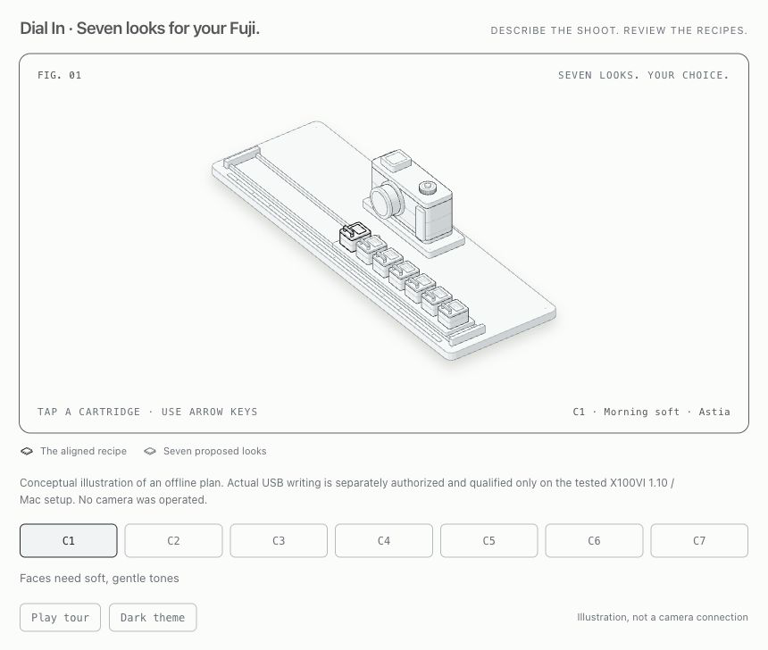

# Walkthrough media and credits

The 30-second edited walkthrough shows two separate demonstrations: an Anatomy diagram of seven proposed camera looks, then the real generated Best, Series and Sequence gallery from the NASA archive example. It is an edited explanation, not an uninterrupted recording of a shoot.

[Watch or download the MP4](workflow.mp4) · [Animated GIF](workflow.gif) · [Interactive illustration source](anatomy.html)



To interact with the illustration after cloning, open `docs/media/anatomy.html` in your browser. It is a standalone file; no install or server is needed. Choose C1–C7, use arrow keys, pause the tour or switch themes. Reduced-motion preferences disable the automatic tour.

## Transcript

There is no audio. The MP4 is 30 seconds; the GIF uses the same sequence.

| Time | What you see | What it means |
|---|---|---|
| 0–14s | The seven-cartridge camera illustration moves from C1 toward C5. The name and film simulation follow the aligned cartridge. | A description became seven proposed looks assigned to explicit camera slots. This is an explanatory drawing of the validated offline plan, not camera hardware or an upload screen. |
| 14–19s | The generated gallery's Best section shows the water-bank and horizon photographs. | The saved review selected three individual favorites; two are visible in this viewport. |
| 19–23s | The three-image Series, “The thin edge.” | The saved edit groups photographs around a shared visual idea. |
| 23–27s | “Earth from daylight to night,” the five-image Sequence. | A deliberate editorial order, with its first two frames visible. |
| 27–30s | The last photograph and the gallery's source credits. | NASA photographs remain attributed; the exported originals were copied unchanged. |

The first segment is a browser recording assembled from timestamped screen captures at normal speed. The gallery views are held screenshots of the generated output. Encoding changes frame rate, size and padding; it does not create photographs or simulate a successful device operation. The poster is a still of the conceptual illustration. Exact release bytes are recorded in [the reviewed-media manifest](../../release/media-manifest.json).

## Seven-look figure

The interactive `anatomy.html` figure illustrates a fictional brief:

> A day in Miami: soft morning portraits, colorful streets at noon, shaded cafe, sunset by the water, indoor dinner, night neon, and one black-and-white documentary look.

On 2026-10-19, the host agent read Dial In's generated request, engine instructions, output schema and original recipe guidance, then authored a new answer for this brief. Finalization produced a complete seven-look proposal with zero validation warnings. Offline camera preparation accepted all seven explicit placements for the **declared demo profile X100VI / firmware 1.10 / USB**. All rendering settings were unchanged between the answer, finalized plan and preparation.

| Slot | Proposed name | Film simulation |
|---|---|---|
| C1 | Morning soft | Astia |
| C2 | Noon color | Reala Ace |
| C3 | Street B&W | Acros+Ye |
| C4 | Cafe shade | Pro Neg Hi |
| C5 | Water sunset | Velvia |
| C6 | Dinner light | Pro Neg Std |
| C7 | Neon color | Eterna |

The diagram's colors and moving parts explain slot selection; they do not simulate the photographic rendering. These look designs remain untested aesthetic proposals. The original run used no photograph, private recipe catalog, separate model API or camera connection. The public figure contains only the fictional brief and small demonstration model, not the complete local request or computer paths.

The preparation receipt records zero camera, provider and network operations, `backup`, `upload` and `readback` as `NOT_RUN`, and `transfer_authorized: false`. Neither the figure nor the walkthrough shows an upload. Actual USB writes are separately qualified only for the X100VI on firmware 1.10 under the [documented device workflow](../../modules/camera/README.md#explicit-usb-use-from-the-computer). A proposal does not establish a connected camera's identity, current slots or photographic quality.

The original commands, saved answer and receipt are retained with the local authoring run. To create your own plan, use the [planner guide](../../modules/planner/README.md). Replaying a saved answer validates that proposal again; it is not a new agent answer.

## Anatomy source and rebuild

The figure uses [Anatomy by Ryan](https://github.com/wheresryan22/anatomy), pinned to commit [`1482e8469b0a9e0d8cc18ea2740a01423d29ae80`](https://github.com/wheresryan22/anatomy/tree/1482e8469b0a9e0d8cc18ea2740a01423d29ae80). Anatomy is MIT-licensed, copyright 2026 Ryan; its [complete license](../../third_party/licenses/anatomy.txt) is included. Dial In's seven-slot model and explanatory copy are original additions. Anatomy does not validate or endorse the camera plan.

The build reads an explicitly supplied local checkout of that revision. It generates SVG geometry with the kit and inlines its CSS and license into the standalone HTML; it does not bundle a kit JavaScript runtime. The small model records the normalized slots above and the source plan SHA-256, `ee31e01853f5dde41be774251fb218f2a23e7679157793b81c13079d3692071e`. It does not install a skill globally or contact a camera or model provider.

```sh
git clone https://github.com/wheresryan22/anatomy.git .dialin/anatomy-source
git -C .dialin/anatomy-source checkout --detach 1482e8469b0a9e0d8cc18ea2740a01423d29ae80
node docs/media/build-anatomy.mjs --anatomy-root .dialin/anatomy-source \
  --out docs/media/anatomy.html --audit
```

The clone command explicitly downloads the upstream source. Keep the Anatomy copyright and permission notice with the inlined code and redistributed figure. The standalone HTML is the conceptual figure; the walkthrough's gallery segment comes from the separate photo workflow below.

## NASA gallery and replay

The gallery segment shows actual output from the [Earth from orbit example](../../examples/photos/earth-from-orbit/README.md), using eight exact, hash-pinned NASA archive JPEGs. The original photographs come from different dates and expeditions. They are not Miami photographs, Fujifilm samples, a chronological flight record or output from the seven proposed looks.

The recording uses the saved review replay: three Best photographs, the three-image Series “The thin edge,” and a five-image Sequence. That replay maps the previously saved Codex review to exact image hashes and runs the normal finish/export path. The original review was authored after viewing all eight previews on 2026-10-19; replaying it for this walkthrough performs no fresh visual or image-quality review and makes no model call. See the example's [download and replay commands](../../examples/photos/earth-from-orbit/README.md#download-and-prepare) and [saved decisions](../../examples/photos/earth-from-orbit/saved-review.json).

The [source manifest](../../examples/photos/earth-from-orbit/sources.json) is the source of truth for image URLs, credits, byte counts and SHA-256 hashes. The finished gallery carries `CREDITS.md` and `SOURCES.json`. Credits for the complete eight-image example are:

| NASA archive image | Credit |
|---|---|
| [iss039e012272](https://images.nasa.gov/details/iss039e012272) | NASA / Steve Swanson |
| [iss036e032513](https://images.nasa.gov/details/iss036e032513) | NASA / Karen Nyberg |
| [iss007e08259](https://images.nasa.gov/details/iss007e08259) | NASA |
| [iss039e012534](https://images.nasa.gov/details/iss039e012534) | NASA / Steve Swanson |
| [iss037e026714](https://images.nasa.gov/details/iss037e026714) | NASA / Karen Nyberg |
| [iss039e009160](https://images.nasa.gov/details/iss039e009160) | NASA / Rick Mastracchio |
| [iss023e057948](https://images.nasa.gov/details/iss023e057948) | NASA |
| [iss022e005258](https://images.nasa.gov/details/iss022e005258) | NASA / Jeffrey Williams, Expedition 22 Commander |

NASA image portions in the video and GIF remain subject to [NASA's media usage guidelines](https://www.nasa.gov/nasa-brand-center/images-and-media/); they are not relicensed under Dial In's MIT license. This is an informational example with source acknowledgment, not NASA endorsement. NASA's guidelines distinguish its content from marked third-party copyrighted material and separately protect its branding. Preserve the credits when sharing. The editorial judgments are by Codex, not NASA. No source photograph was generated or retouched by AI; the walkthrough contains ordinary gallery screenshots and video encoding.
