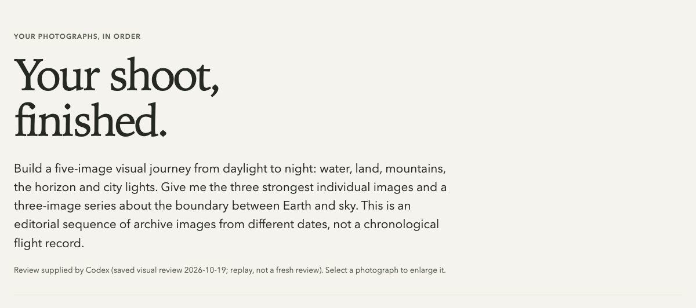

# Illustration and gallery sources

The README has two separate visuals: a seven-second camera illustration and a still of the generated photo gallery. Neither is a recording of the owner using a camera.

## Seven-look illustration


The camera stays fixed while C1–C7 highlight in order, one second per slot, with a short crossfade. The loop contains no controls, conveyor movement or gallery footage. The GIF is rendered from vector paths at **1200 × 640**, **25 fps**, and displayed at **600 × 320** in the README. The MP4 encodes the same seven-second illustration; it is not a separate overview.

The README supplies this static poster for reduced-motion preferences. The standalone `anatomy.html` uses CSS for the same slot-highlighting sequence and keeps C1 selected when reduced motion is requested. Open that file locally after cloning. There is no JavaScript, installation, server or camera connection involved in viewing it. The static [SVG source](workflow.svg) stays sharp at any size.

The illustration uses seven proposals from the original fictional brief:

> A day in Miami: soft morning portraits, colorful streets at noon, shaded cafe, sunset by the water, indoor dinner, night neon, and one black-and-white documentary look.

| Slot | Proposed name | Film simulation |
|---|---|---|
| C1 | Morning soft | Astia |
| C2 | Noon color | Reala Ace |
| C3 | Street B&W | Acros+Ye |
| C4 | Cafe shade | Pro Neg Hi |
| C5 | Water sunset | Velvia |
| C6 | Dinner light | Pro Neg Std |
| C7 | Neon color | Eterna |

On October 19, 2026, the host agent authored these proposals using Dial In's request, engine instructions, schema and original recipe guidance. Finalization and offline camera preparation accepted the seven placements without changing their rendering settings, for the declared demo profile **X100VI / firmware 1.10 / USB**. The original run used no photograph, private recipe catalog, separate model API or camera connection. The proposals remain untested aesthetic choices.

The preparation receipt recorded zero camera, provider and network operations; backup, upload and readback were not run. Highlighting a slot is an illustration of a proposal, not evidence of a camera write. See the [planner guide](../../modules/planner/README.md) and [documented USB workflow](../../modules/camera/README.md#explicit-usb-use-from-the-computer).

## Vector source and rebuild

The camera geometry uses [Anatomy by Ryan](https://github.com/wheresryan22/anatomy), pinned to commit [`1482e8469b0a9e0d8cc18ea2740a01423d29ae80`](https://github.com/wheresryan22/anatomy/tree/1482e8469b0a9e0d8cc18ea2740a01423d29ae80). Anatomy is MIT-licensed, copyright 2026 Ryan; its [complete license](../../third_party/licenses/anatomy.txt) is included and inlined into the SVG and HTML. Dial In's layout, animation, colors and seven-look model are original additions. Anatomy does not validate or endorse the plan.

The builder reads an explicitly supplied checkout of that revision. It makes no camera, model or network calls and refuses an existing output directory. Its static camera geometry passes the kit's clearance, support and depth-order audit. The source plan SHA-256 remains `ee31e01853f5dde41be774251fb218f2a23e7679157793b81c13079d3692071e`.

To regenerate SVG and standalone HTML:

```sh
git clone https://github.com/wheresryan22/anatomy.git .dialin/anatomy-source
git -C .dialin/anatomy-source checkout --detach 1482e8469b0a9e0d8cc18ea2740a01423d29ae80
node docs/media/build-anatomy.mjs --anatomy-root .dialin/anatomy-source \
  --out-dir .dialin/illustration --audit
```

The clone explicitly downloads upstream source. For PNG, GIF and MP4 output, install the optional renderer in a separate local folder and make FFmpeg available on your path:

```sh
npm install --prefix .dialin/media-render-tools --ignore-scripts --no-audit --no-fund @resvg/resvg-js@2.6.2
node docs/media/build-anatomy.mjs --anatomy-root .dialin/anatomy-source \
  --out-dir .dialin/illustration-rendered --audit \
  --renderer .dialin/media-render-tools/node_modules/@resvg/resvg-js/index.js
```

Rendering uses locally installed Georgia and Avenir Next, with serif/sans fallbacks. Font availability and FFmpeg versions can change raster bytes; review regenerated output before updating its exact hashes in [the media manifest](../../release/media-manifest.json). Neither the optional renderer nor a browser is part of installation or routine tests.

## NASA gallery example



This separate still is an unretouched browser capture of the generated gallery's Best section, showing two of its three picks. It was captured at 1200 × 532 pixels and displayed at 600 pixels wide. It shows actual output from the [Earth from orbit example](../../examples/photos/earth-from-orbit/README.md), with the saved review replay: three Best photographs, the three-image Series “The thin edge,” and a five-image Sequence. The original visual review was authored after opening all eight previews on October 19, 2026. Capturing this preview is not a new photographic review.

To recreate the gallery, follow the example's [download and replay commands](../../examples/photos/earth-from-orbit/README.md#download-and-prepare). The capture shows the beginning of the Best section; it is not the complete gallery. The visible photographs are `iss039e012272` (NASA / Steve Swanson) and `iss023e057948` (NASA).

The archive photographs come from different dates and expeditions. They are not Miami photographs, Fujifilm samples, a chronological flight record or output from the proposed camera looks. Originals are unchanged. The [source manifest](../../examples/photos/earth-from-orbit/sources.json) records URLs, credits and pinned image hashes; the gallery carries its own `CREDITS.md` and `SOURCES.json`.

Credits for the complete example:

| NASA archive image | Credit |
|---|---|
| [iss039e012272](https://images.nasa.gov/details/iss039e012272) | NASA / Steve Swanson |
| [iss036e032513](https://images.nasa.gov/details/iss036e032513) | NASA / Karen Nyberg |
| [iss007e08259](https://images.nasa.gov/details/iss007e08259) | NASA |
| [iss039e012534](https://images.nasa.gov/details/iss039e012534) | NASA / Steve Swanson |
| [iss037e026714](https://images.nasa.gov/details/iss037e026714) | NASA / Karen Nyberg |
| [iss039e009160](https://images.nasa.gov/details/iss039e009160) | NASA / Rick Mastracchio |
| [iss023e057948](https://images.nasa.gov/details/iss023e057948) | NASA |
| [iss022e005258](https://images.nasa.gov/details/iss022e005258) | NASA / Jeffrey Williams, Expedition 22 Commander |

NASA image portions in the gallery preview remain subject to [NASA's media usage guidelines](https://www.nasa.gov/nasa-brand-center/images-and-media/); they are not relicensed under Dial In's MIT license. This is an informational example with source acknowledgment, not NASA endorsement. NASA's guidelines distinguish its content from marked third-party copyrighted material and separately protect its branding. Preserve the credits when sharing. The editorial judgments are by Codex, not NASA. No source photograph was generated or retouched by AI; the gallery preview is an ordinary browser screenshot.
